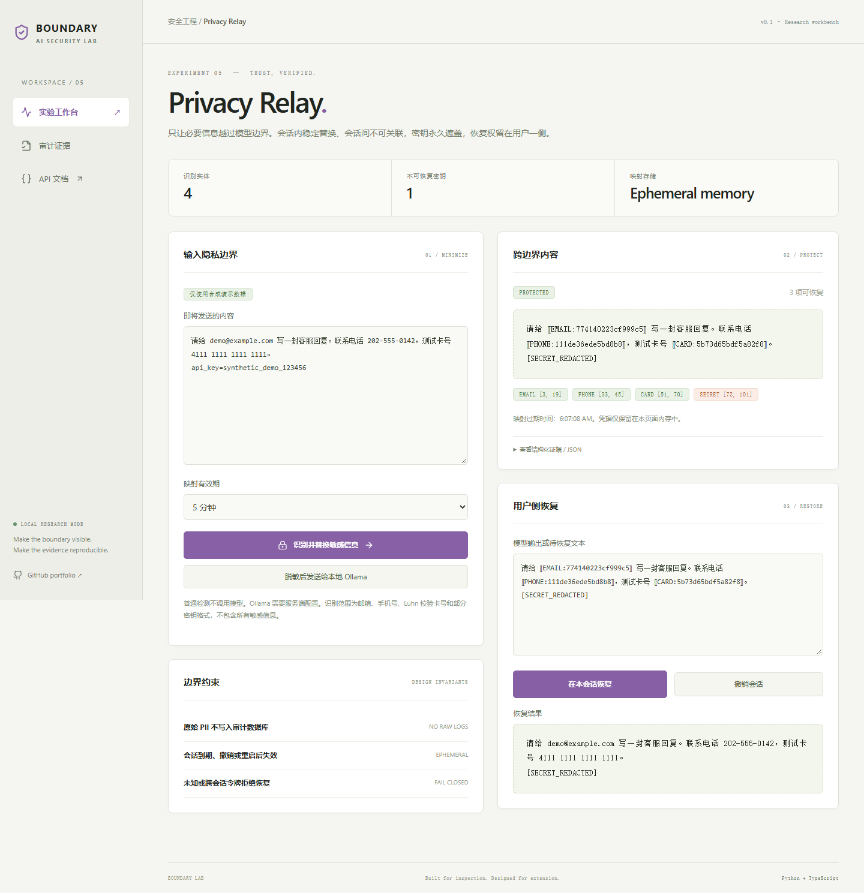
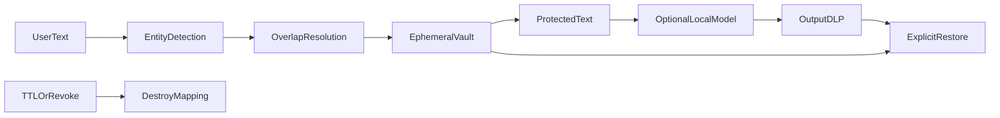

# Privacy Relay

**面向模型流量的会话级隐私网关**  
An ephemeral privacy boundary with session-scoped stable tokens, irreversible secret redaction, TTL revocation and optional sanitized local-model relay.

[](https://github.com/rodriguezrobertbfrkx6857-sudo/privacy-relay/actions/workflows/ci.yml)
  



## 为什么做

直接把用户请求转发给模型会扩大个人信息与密钥的暴露范围。这个项目在发送前识别并替换已支持的敏感实体，保留会话内一致性，并将恢复操作留在用户侧。

本项目是可运行、可扩展的安全工程作品集原型。没有宣称研究算法原创、生产认证、真实用户规模或未执行的大模型实验。核心差异在可检查的实现、失败行为和证据闭环。

## 已实现

- 邮箱、部分手机号、Luhn 校验卡号与部分密钥格式识别；重叠匹配按优先级消解。
- 同一会话中同一实体稳定替换，不同会话使用独立随机令牌；所有映射只保留在进程内存。
- TTL、主动撤销、每会话字符预算与全局会话数量上限；跨会话或未知令牌拒绝恢复。
- 密钥不可逆遮盖；可选 Ollama 转发只接收脱敏输入，输出再做 DLP；审计只写实体数量等元数据。

## 本地启动

需要 Python 3.12+、uv、Node.js 22.12+。默认不需要模型密钥。

```bash
git clone https://github.com/rodriguezrobertbfrkx6857-sudo/privacy-relay.git
cd privacy-relay
uv sync --frozen
cd web
npm ci
npm run build
cd ..
uv run uvicorn app.main:app --host 127.0.0.1 --port 8115
```

浏览器访问 http://127.0.0.1:8115 ，API 文档位于 `/docs`。Windows 也可运行 `./run.ps1`。

Docker：`docker compose up --build`。Compose 仅将服务绑定到本机环回地址。镜像使用非 root 用户；数据存放在命名卷。Docker 构建与健康检查由 CI 执行，状态以 Actions 结果为准。

开发热更新：终端 A 启动上述后端命令并增加 `--reload`；终端 B 在 `web/` 执行 `npm run dev`，Vite 将 `/api` 代理至 8115。

## 三分钟演示

1. 运行预填的合成数据，观察邮箱、电话、卡号变成令牌，密钥变成不可恢复遮盖。
2. 在用户侧恢复文本，确认 PII 恢复而密钥仍保持遮盖。
3. 撤销会话或选择 30 秒 TTL，再尝试恢复；查看元数据审计不含原始敏感内容。

## 架构



技术栈：FastAPI / Pydantic、SQLite WAL、React 19 / TypeScript / Vite、pytest、Playwright、GitHub Actions。前后端同源发布，不需要独立代理即可运行。

目录：`app/` 核心逻辑与 API，`web/src/` 交互界面，`tests/` 单元/集成/对抗测试，`web/e2e/` 浏览器测试，`fixtures/` 合成演示数据，`docs/` 架构与验证证据。

## API

| 接口 | 约定 |
| --- | --- |
| `POST /api/protect` | text, ttl, optional session_token → protected text |
| `POST /api/restore` | text + session_token → restored text |
| `POST /api/revoke` | session_token → revoke |
| `POST /api/relay` | 保护输入 → 本地 Ollama → 输出 DLP |
| `GET /api/health` | 健康与版本 |
| `GET /api/audit` | 元数据审计记录与链校验 |

所有请求体限制为 128 KiB；领域模型拒绝未声明字段。错误使用标准 HTTP 状态码，UI 显式呈现错误。

## 验证

```bash
uv run ruff check app tests
uv run pytest --cov=app --cov-report=term-missing
cd web
npm run build
npx playwright install chromium
npm run test:e2e
```

浏览器测试使用独立 `data/e2e.sqlite3`，覆盖主工作流、审计与 390px 移动布局。可用 `UPDATE_SCREENSHOTS=1` 更新截图（PowerShell 使用 `$env:UPDATE_SCREENSHOTS='1'`）。

实际检查结果及局限见 [VALIDATION.md](docs/VALIDATION.md)。安全设计见 [SECURITY.md](SECURITY.md)。

## 边界与取舍

- 模式识别不能覆盖姓名、地址、语义身份特征、所有地区手机号或经过编码的秘密，不是完整 DLP。
- 原始 PII 仍短暂存在服务端内存与用户页面中；不是加密计算，也不保护已被攻陷的服务器。
- 映射在重启后失效，单 worker 是当前要求；多 worker 或多副本需要独立安全 vault。
- TTL 在访问/新建会话时惰性清理；过期数据可能仍占内存至下一次访问，但不能再通过 API 恢复。
- session_token 是恢复权限凭据，不写入磁盘、URL 或审计；需防止客户端 XSS 与凭据泄露。

审计使用 SHA256 链，可发现已保存事件的内容修改或重排；没有外部锚定，无法检测整链重写或尾部截断，因此不是防管理员篡改的不可变账本。

## 可扩展路线（尚未实现）

- [ ] 接入多语言 NER 与 Presidio 类识别器，建立按实体类型划分的精确率/召回率基准。
- [ ] 使用独立加密 vault、密钥轮换和租户身份约束，支持多实例并发与严格定时销毁。
- [ ] 增加敏感字段的数据流追踪、结构化 JSON 处理和跨工具输出策略。

## 简历与讲解

见 [RESUME.md](docs/RESUME.md)：提供中文/英文讲解框架、可验证表述和面试问题。只写自己能复现和解释的功能；不要将原型描述为企业生产项目。

## 相关工作与资料

- [OWASP Prompt Injection](https://genai.owasp.org/llmrisk/llm01-prompt-injection/)：应用层威胁与防御背景。
- [NIST Adversarial ML Taxonomy](https://doi.org/10.6028/NIST.AI.100-2e2025)：威胁术语与分类。
- [Anthropic: Demystifying evals](https://www.anthropic.com/research/demystifying-evals-for-ai-agents)：评测与评分器设计背景。
- [NVIDIA garak](https://github.com/NVIDIA/garak)、[LLM Guard](https://github.com/protectai/llm-guard)、[Presidio](https://github.com/microsoft/presidio)：相邻领域成熟开源系统，适合后续对照与集成。本项目没有复制这些仓库的实现，也没有声称性能超过它们。
- [Ollama chat API](https://docs.ollama.com/api/chat)：可选本地模型协议。

同系列：[Sentinel Gate](https://github.com/rodriguezrobertbfrkx6857-sudo/sentinel-gate) · [Evidence RAG](https://github.com/rodriguezrobertbfrkx6857-sudo/evidence-rag) · [Agent Permit](https://github.com/rodriguezrobertbfrkx6857-sudo/agent-permit) · [Redteam Ledger](https://github.com/rodriguezrobertbfrkx6857-sudo/redteam-ledger)

## 许可证

代码 MIT。原创合成 fixtures 以 CC0-1.0 提供；依赖遵循各自许可证。仓库不包含第三方私有数据、模型权重或真实密钥。

## 可选本地模型

先自行安装并拉取适合硬件的 Ollama 模型，再设置环境变量（仓库不自动下载权重）：

```powershell
$env:OLLAMA_MODEL = 'your-installed-model-name'
$env:OLLAMA_URL = 'http://127.0.0.1:11434'
```

重新启动服务后选择 Ollama 模式。URL 只来自可信服务端配置，API 调用者不能指定请求目标；不跟随 HTTP 重定向。当前交付验证了适配器契约及失败路径，真实模型质量需要在配置模型后独立评测。
